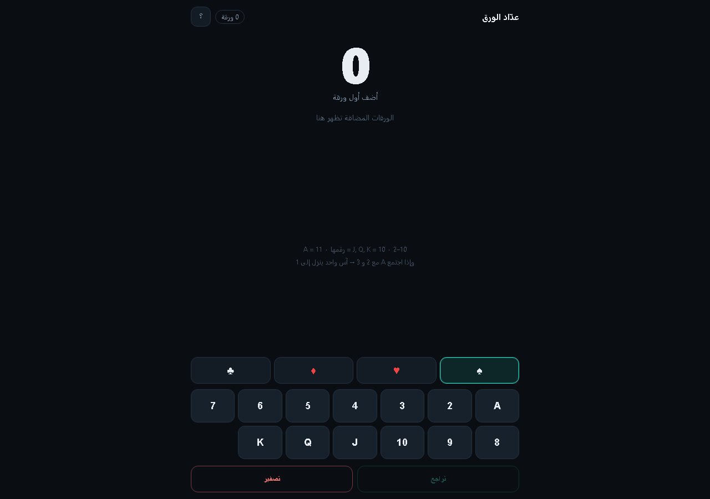

# عدّاد الورق

عدّاد سريع لمجموع أوراق اللعب، بملف HTML واحد يعمل بدون إنترنت وبدون تثبيت.

## المزايا

- إضافة الأوراق بضغطة واحدة مع اختيار النوع (قلوب، ديناري، هاص، سباتي).
- حساب تلقائي للقيمة (A = 11 أو 1، والصور = 10).
- تراجع عن آخر ورقة، وجولة جديدة.
- حفظ تلقائي للحالة في المتصفح (localStorage).
- واجهة عربية (RTL) بسيطة وسريعة.

## التشغيل

افتح `card-counter.html` في أي متصفح حديث، أو استضفه كصفحة ثابتة.

## الترخيص

[MIT](LICENSE)
